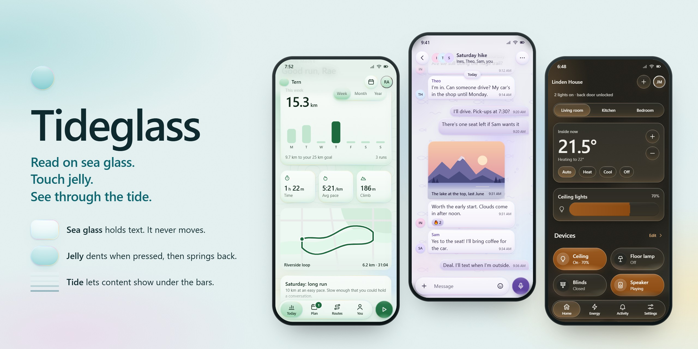
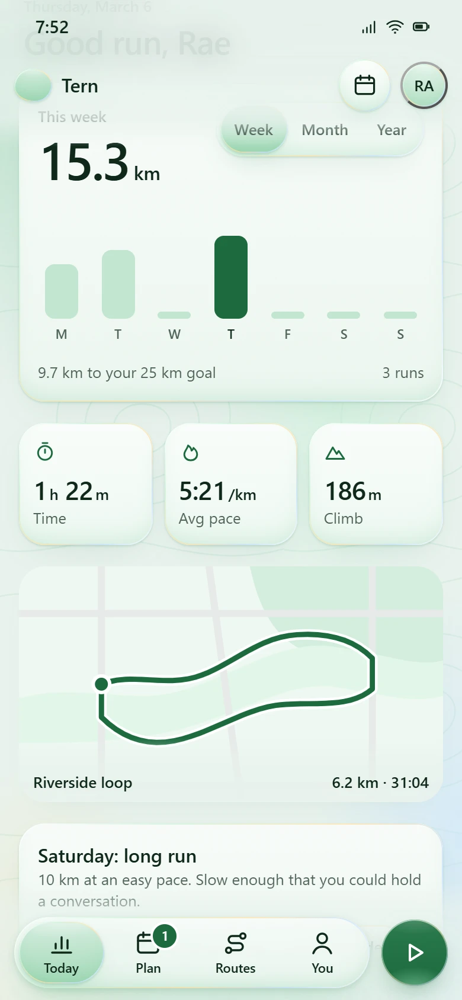
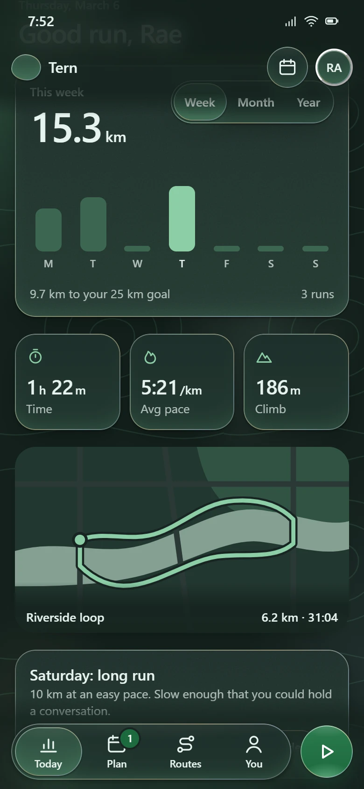
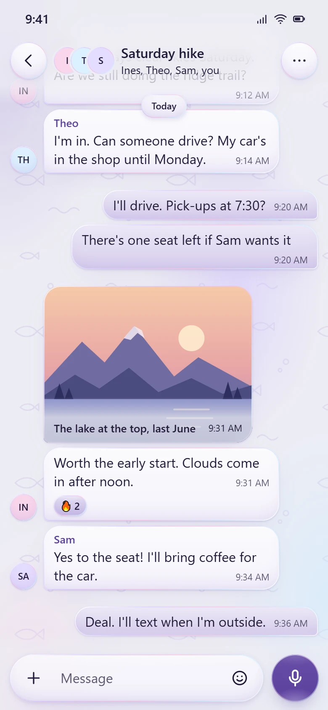
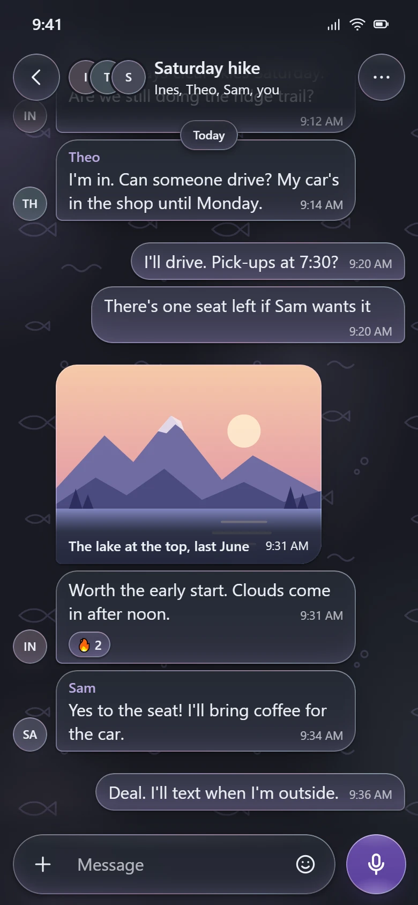
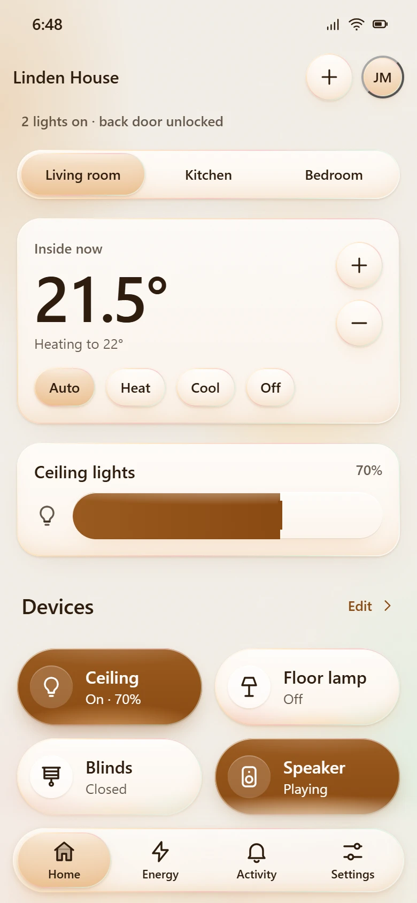
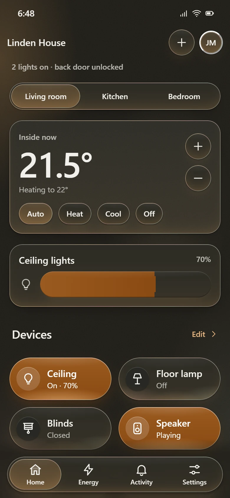

# Tideglass

**Read on sea glass. Touch jelly. See through the tide.**

Tideglass is a design standard for app interfaces. Text sits on frosted, tinted sea glass. Buttons and other controls are soft jelly that dents when you press and springs back when you let go. At the top and bottom of a scrolling screen, a clear tide lets content show through the bars.

It comes with a spec of numbered rules, a web kit with no dependencies, design tokens, SwiftUI and Compose recipes, and a Claude skill. It's meant as an alternative to Apple's Liquid Glass; [the differences](#not-liquid-glass) are below.

Made by [@DiptamoyBarman](https://x.com/DiptamoyBarman).



## The three materials

| | Sea glass | Jelly | Tide |
|---|---|---|---|
| **For** | Reading: cards, lists, bubbles, sheets, menus | Touching: buttons, tabs, chips, tiles, the orb | Seeing through: bars at scroll edges, captions on photos |
| **Looks** | Frosted, softly tinted, matte, with a still 1px pastel rim | Soft and lit from inside: a sheen on top, light gathered at the bottom | A veil that's dense where the text sits and fades to clear where content shows through |
| **Moves** | Never | Dents when pressed, holds for a moment, then springs back with one small rebound | Fades in as content scrolls under it |

To style an element, answer three questions. **What do people do with it?** That picks the material. **Does content scroll underneath?** That picks the thickness: Solid, Thin, Regular or Thick. **How important is it?** That picks the layer: Foam, Shallow, Lagoon or Deep. Its size then sets how much it squishes.

Three made-up apps, each with its own brand color and layout, in light and dark:

| | Light | Dark |
|---|---|---|
| **Running tracker**, kelly |  |  |
| **Group chat**, lavender |  |  |
| **Smart home**, amber |  |  |

## Not Liquid Glass

| | Liquid Glass | Tideglass |
|---|---|---|
| Surface | Clear, bends what is behind (lensing) | Frosted, softens what is behind |
| Color | Borrows color from content | Carries its own brand tint |
| Edge | Moving specular highlight | Still 1px pastel rim |
| Press | Glows and grows | Dents, sticks, peels out with one rebound |
| Navigation | Controls morph | One jelly blob glides, stretches, and follows your finger |
| Scroll edge | Edge effect | The tide: a liquid veil with a dense band for text |
| Text on glass | Adaptive vibrancy | Only where contrast is proven against the worst backdrop |

## Quick start

```html
<!doctype html>
<html lang="en" data-tg-brand="seafoam">
<head>
  <meta name="viewport" content="width=device-width, initial-scale=1, viewport-fit=cover">
  <link rel="stylesheet" href="kit/tideglass.css">
  <link rel="stylesheet" href="kit/tideglass-presets.css">
</head>
<body class="tg-ground tg-grain">
  <header class="tg-tide tg-tide-top" data-tide="auto">
    <div class="tg-appbar"><span class="tg-appbar-title">Inbox</span></div>
  </header>

  <main style="padding:16px">
    <div class="tg-card">Read on sea glass.</div>
    <button class="tg-btn tg-deep">Touch jelly</button>
  </main>

  <div class="tg-tide tg-tide-bottom">
    <nav class="tg-dock">
      <div class="tg-tabbar tg-regular is-fill">
        <span class="tg-blob" aria-hidden="true"></span>
        <a class="tg-tab" href="#" aria-current="page">Home</a>
        <a class="tg-tab" href="#">You</a>
      </div>
    </nav>
  </div>
  <script src="kit/tideglass.js"></script>
</body>
</html>
```

No build step and no dependencies: two stylesheets and one script. Or install from GitHub:

```sh
npm install github:cocaina999/Tideglass-standard
```

```js
import 'tideglass/css';
import 'tideglass/presets.css';
import Tideglass from 'tideglass';
```

**Rebrand** with six inputs (tint, deep, ink and three rim pastels), or pick a preset: `seafoam`, `cornflower`, `lavender`, `amber`, `kelly`, `coral`. Dark mode, states and shadows are all derived from those six, and `npm run check` confirms every preset passes 15 contrast pairs in both themes.

## Demos

**Live:** [cocaina999.github.io/Tideglass-standard](https://cocaina999.github.io/Tideglass-standard/). Or open the files directly in a browser; they work from `file://`.

| Demo | Shows |
|---|---|
| [demo/index.html](demo/index.html) | The specimen: materials, layers, thickness, touch tiers, navigation, components and accessibility settings, with a brand and theme switcher |
| [demo/fitness.html](demo/fitness.html) | A running tracker: week chart with a range switch, stat cards, a route map with a tide caption, reminder chips, and a tab bar with a start orb |
| [demo/messages.html](demo/messages.html) | A group chat: messages scroll under the tide header, sender faces and names, a photo with a tide caption, long-press reactions, and a send that gets a reply |
| [demo/smart-home.html](demo/smart-home.html) | A smart home: room tabs, a thermostat, a dimmer, device toggle tiles, scenes, and a firm "Lock all doors" button |

Each app has its own default brand. Any demo takes URL parameters to override it: `?brand=coral&theme=dark&motion=reduce&transparency=reduce&contrast=more`.

## What is in the repo

```
tideglass/
├── SKILL.md              The Claude skill: the working summary for AI agents
├── spec/                 The standard, in 12 chapters with numbered rules
├── kit/                  tideglass.css, tideglass-presets.css, tideglass.js
├── tokens/               DTCG design tokens, generated from the CSS
├── demo/                 The specimen and three demo apps
├── docs/                 README images and the social preview
└── tools/                Checks, token generation, springs, browser tests, screenshots
```

## The standard

[spec/README.md](spec/README.md) is the entry point. Every chapter ends in numbered rules (**TO-4**, **NA-3**…) written with RFC 2119 *must* and *should*, so a review comment can cite them. [Chapter 12](spec/12-review.md) is the ship checklist.

1. [Foundations](spec/01-foundations.md) · 2. [Color](spec/02-color.md) · 3. [Materials](spec/03-materials.md) · 4. [Touch](spec/04-touch.md) · 5. [Motion](spec/05-motion.md) · 6. [Navigation](spec/06-navigation.md) · 7. [Layout](spec/07-layout.md) · 8. [Type and icons](spec/08-type-and-icons.md) · 9. [Components](spec/09-components.md) · 10. [Accessibility](spec/10-accessibility.md) · 11. [Platforms](spec/11-platforms.md) · 12. [Review](spec/12-review.md) · [Glossary](spec/glossary.md)

## Use it as a Claude skill

[SKILL.md](SKILL.md) gives Claude the standard in short form: the three questions, the hard rules, the kit's markup and the review checklist. Install it for Claude Code by cloning into your skills folder:

```sh
git clone https://github.com/cocaina999/Tideglass-standard ~/.claude/skills/tideglass
```

Or clone it into a project's `.claude/skills/tideglass` to share it with a team. Then ask for a screen "in Tideglass" or "with the Tideglass skill".

## Native platforms

[spec/11-platforms.md](spec/11-platforms.md) has SwiftUI and Jetpack Compose recipes for the surface, the dent-and-peel press, springs and haptics. [tokens/tideglass.tokens.json](tokens/tideglass.tokens.json) follows the W3C Design Tokens Format (2025.10) for Style Dictionary, Tokens Studio or your own pipeline. `npm run springs` prints every spring for CSS, SwiftUI, Compose and Motion.

## Tooling

Requires Node 18+. `npm install` once (the only dev dependency is `puppeteer-core`, which drives your installed Chrome or Edge).

| Command | Does |
|---|---|
| `npm run check` | Contrast for every preset in both themes, spring curves, generated files, versions, syntax, links, kit classes documented, every rule in the checklist |
| `npm run smoke` | Drives the demos in headless Chrome: dent and peel, tiers, drag-off, long-press, the blob, keyboard, overlays, accessibility settings, theme scoping |
| `npm run tokens` | Regenerates the tokens and the contrast report from the CSS |
| `npm run springs` | Prints the springs for every platform |
| `npm run shots` | Re-renders the images in `docs/assets` |

Set `CHROME_PATH` if your browser is somewhere unusual.

## Browser support

Chrome and Edge 115+, Safari 17.2+, Firefox 128+. Older browsers still work: springs fall back to cubic-bezier curves, auto tides stay on, and glass without `backdrop-filter` stays readable because contrast is measured without counting on blur.

## Accessibility

Reduce motion, reduce transparency, increase contrast, forced colors, dark mode and 200% text all work, whether they come from the OS or from an in-app setting. Everything you can do by touch, you can do from the keyboard. Text only goes on glass where its contrast has been measured against the worst backdrop that can sit behind it. See [chapter 10](spec/10-accessibility.md).

## Contributing

See [CONTRIBUTING.md](CONTRIBUTING.md). Changes to the standard follow semantic versioning, and the kit, tokens and spec share one version.

## License

[MIT](LICENSE). Tideglass is an independent project and is not affiliated with Apple. Made by [@DiptamoyBarman](https://x.com/DiptamoyBarman).
