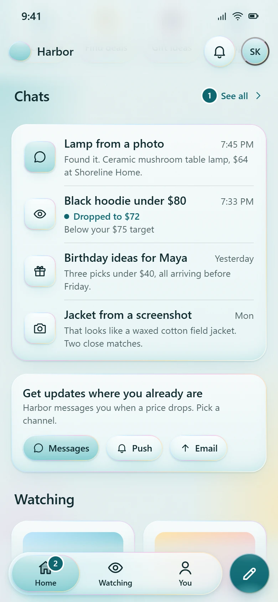
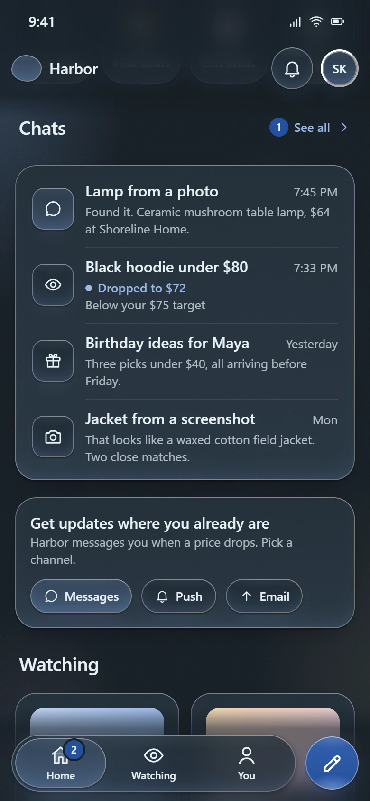
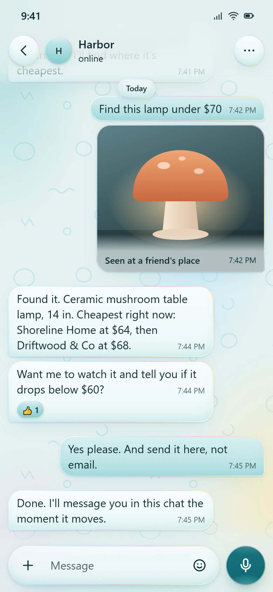
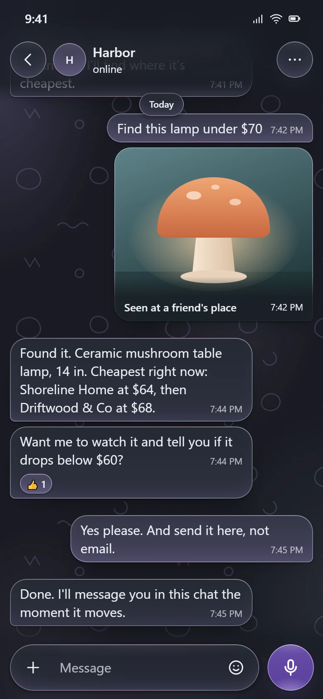
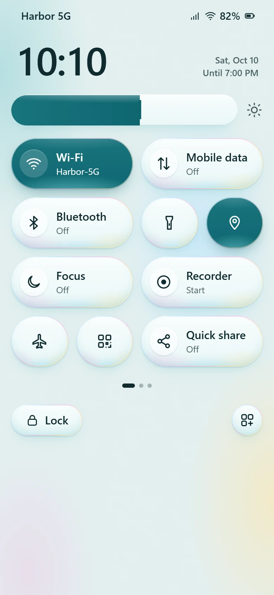
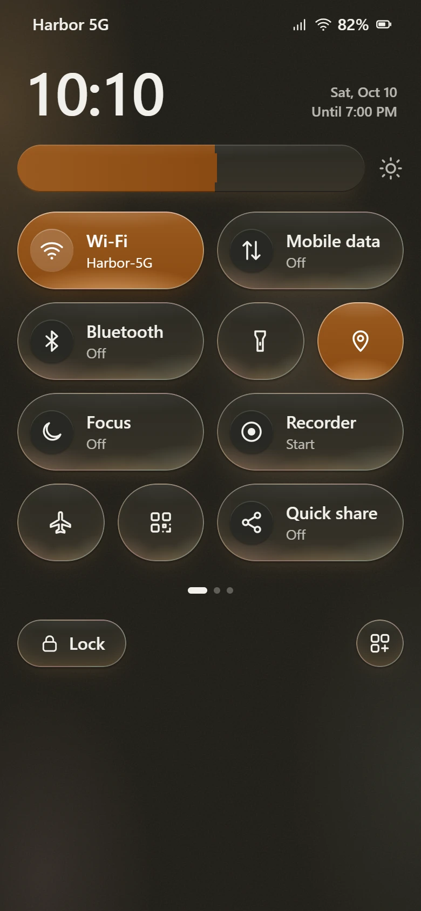

# Tideglass

**Read on sea glass. Touch jelly. See through the tide.**

Tideglass is a premium UI material and touch standard: frosted sea glass for the things you read, squishy jelly for the things you touch, and a liquid tide at the scroll edges where content keeps showing through. It is a deliberate alternative to Apple's Liquid Glass, with a full spec, a dependency-free web kit, design tokens, native recipes and a Claude skill.


## The three materials

| | Sea glass | Jelly | Tide |
|---|---|---|---|
| **For** | Reading: cards, lists, bubbles, sheets, menus | Touching: buttons, tabs, chips, tiles, the orb | Seeing through: bars at scroll edges, captions on photos |
| **Looks** | Frosted, softly tinted, matte, a still 1px pastel rim | Gummy and lit from inside: still sheen on top, glow pooling at the bottom, tinted light below | A liquid veil: dense where the text sits, fading to clear where content shows through |
| **Moves** | Never. Reading surfaces stay still. | Dents under your finger, clings for a beat, peels back with one soft rebound | Rises as content scrolls under it |

Every element answers three questions, and the answers decide its look: **what do you do with it** (material), **does content pass underneath** (thickness: Solid, Thin, Regular, Thick), and **how important is it** (layer: Foam, Shallow, Lagoon, Deep). Size picks how strongly it squishes.

| Light | Dark |
|---|---|
|  |  |
|  |  |
|  |  |

## Not Liquid Glass

| | Liquid Glass | Tideglass |
|---|---|---|
| Surface | Clear, bends what is behind (lensing) | Frosted, softens what is behind |
| Color | Borrows color from content | Carries its own brand tint |
| Edge | Moving specular highlight | Still 1px pastel rim |
| Press | Glows and grows | Dents, sticks, peels out with one rebound |
| Navigation | Controls morph | One jelly blob glides, stretches, and follows your finger |
| Scroll edge | Edge effect | The tide: a liquid veil with a dense band for text |
| Text on glass | Adaptive vibrancy | Only where contrast is proven against the worst backdrop |

## Quick start

```html
<!doctype html>
<html lang="en" data-tg-brand="seafoam">
<head>
  <meta name="viewport" content="width=device-width, initial-scale=1, viewport-fit=cover">
  <link rel="stylesheet" href="kit/tideglass.css">
  <link rel="stylesheet" href="kit/tideglass-presets.css">
</head>
<body class="tg-ground tg-grain">
  <header class="tg-tide tg-tide-top" data-tide="auto">
    <div class="tg-appbar"><span class="tg-appbar-title">Inbox</span></div>
  </header>

  <main style="padding:16px">
    <div class="tg-card">Read on sea glass.</div>
    <button class="tg-btn tg-deep">Touch jelly</button>
  </main>

  <div class="tg-tide tg-tide-bottom">
    <nav class="tg-dock">
      <div class="tg-tabbar tg-regular is-fill">
        <span class="tg-blob" aria-hidden="true"></span>
        <a class="tg-tab" href="#" aria-current="page">Home</a>
        <a class="tg-tab" href="#">You</a>
      </div>
    </nav>
  </div>
  <script src="kit/tideglass.js"></script>
</body>
</html>
```

No build step and no dependencies: two stylesheets and one script. Or install from GitHub:

```sh
npm install github:cocaina999/Tideglass-standard
```

```js
import 'tideglass/css';
import 'tideglass/presets.css';
import Tideglass from 'tideglass';
```

**Rebrand** with six inputs (tint, deep, ink and three rim pastels), or pick a preset: `seafoam`, `cornflower`, `lavender`, `amber`, `kelly`, `coral`. Dark mode, every state and every shadow derive from them, and `npm run check` proves every preset passes 15 contrast pairs in both themes.

## Demos

**Live:** [cocaina999.github.io/Tideglass-standard](https://cocaina999.github.io/Tideglass-standard/). Or open the files directly in a browser; they work from `file://`.

| Demo | Shows |
|---|---|
| [demo/index.html](demo/index.html) | The specimen: materials, depths, thickness, touch tiers, navigation, components, accessibility settings, with a live brand and theme switcher |
| [demo/home.html](demo/home.html) | An assistant home with an auto tide header, tiles, a list and a tab bar with an orb |
| [demo/chat.html](demo/chat.html) | A chat with a tide header (messages show through), a composer, long-press reactions and a working send |
| [demo/controls.html](demo/controls.html) | Quick settings: toggle tiles, sliders, round tiles and a firm lock button |

Each demo takes URL parameters: `?brand=lavender&theme=dark&motion=reduce&transparency=reduce&contrast=more`.

## What is in the repo

```
tideglass/
├── SKILL.md              The Claude skill: the working summary for AI agents
├── spec/                 The standard, in 12 chapters with numbered rules
├── kit/                  tideglass.css, tideglass-presets.css, tideglass.js
├── tokens/               DTCG design tokens, generated from the CSS
├── demo/                 The specimen and three app screens
├── docs/                 README images and the social preview
└── tools/                Checks, token generation, springs, browser tests, screenshots
```

## The standard

[spec/README.md](spec/README.md) is the entry point. Every chapter ends in numbered rules (**TO-4**, **NA-3**…) written with RFC 2119 *must* and *should*, so a review comment can cite them. [Chapter 12](spec/12-review.md) is the ship checklist.

1. [Foundations](spec/01-foundations.md) · 2. [Color](spec/02-color.md) · 3. [Materials](spec/03-materials.md) · 4. [Touch](spec/04-touch.md) · 5. [Motion](spec/05-motion.md) · 6. [Navigation](spec/06-navigation.md) · 7. [Layout](spec/07-layout.md) · 8. [Type and icons](spec/08-type-and-icons.md) · 9. [Components](spec/09-components.md) · 10. [Accessibility](spec/10-accessibility.md) · 11. [Platforms](spec/11-platforms.md) · 12. [Review](spec/12-review.md) · [Glossary](spec/glossary.md)

## Use it as a Claude skill

[SKILL.md](SKILL.md) teaches Claude the standard: the three questions, the hard rules, the kit's markup and the review checklist. Install it for Claude Code by cloning into your skills folder:

```sh
git clone https://github.com/cocaina999/Tideglass-standard ~/.claude/skills/tideglass
```

Or clone it into a project's `.claude/skills/tideglass` to share it with a team. Then ask for a screen "in Tideglass" or "with the Tideglass skill".

## Native platforms

[spec/11-platforms.md](spec/11-platforms.md) has SwiftUI and Jetpack Compose recipes for the surface, the dent-and-peel press, springs and haptics. [tokens/tideglass.tokens.json](tokens/tideglass.tokens.json) follows the W3C Design Tokens Format (2025.10) for Style Dictionary, Tokens Studio or your own pipeline. `npm run springs` prints every spring for CSS, SwiftUI, Compose and Motion.

## Tooling

Requires Node 18+. `npm install` once (the only dev dependency is `puppeteer-core`, which drives your installed Chrome or Edge).

| Command | Does |
|---|---|
| `npm run check` | Contrast for every preset in both themes, spring curves, generated files, versions, syntax, links, kit classes documented, every rule in the checklist |
| `npm run smoke` | Drives the demos in headless Chrome: dent and peel, tiers, drag-off, long-press, the blob, keyboard, overlays, accessibility settings, theme scoping |
| `npm run tokens` | Regenerates the tokens and the contrast report from the CSS |
| `npm run springs` | Prints the springs for every platform |
| `npm run shots` | Re-renders the images in `docs/assets` |

Set `CHROME_PATH` if your browser is somewhere unusual.

## Browser support

Chrome and Edge 115+, Safari 17.2+, Firefox 128+. Older engines degrade gracefully: springs fall back to cubic-bezier curves, auto tides stay on, and glass without `backdrop-filter` stays legible because contrast is measured without relying on blur.

## Accessibility

Reduce motion, reduce transparency, increase contrast, forced colors, dark mode and 200% text are first-class outcomes, each honored from the OS and available as an in-app setting. Every touch interaction has a keyboard equivalent, and text is only placed on glass where its contrast is proven against the worst possible backdrop. See [chapter 10](spec/10-accessibility.md).

## Contributing

See [CONTRIBUTING.md](CONTRIBUTING.md). Changes to the standard follow semantic versioning, and the kit, tokens and spec share one version.

## License

[MIT](LICENSE). Tideglass is an independent project and is not affiliated with Apple.
